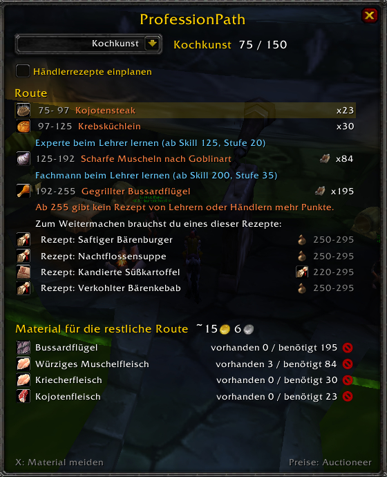
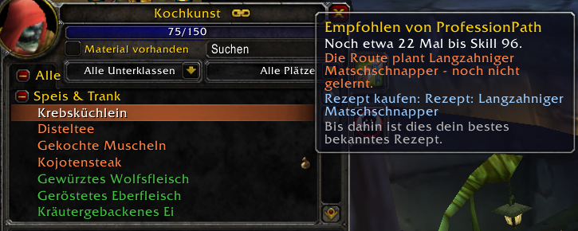
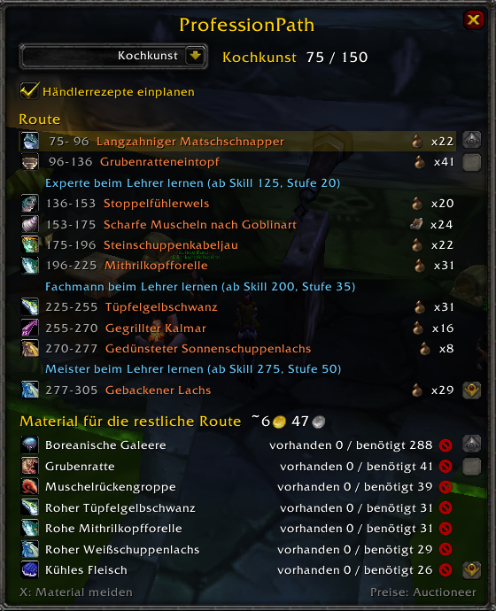
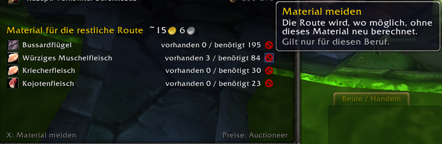
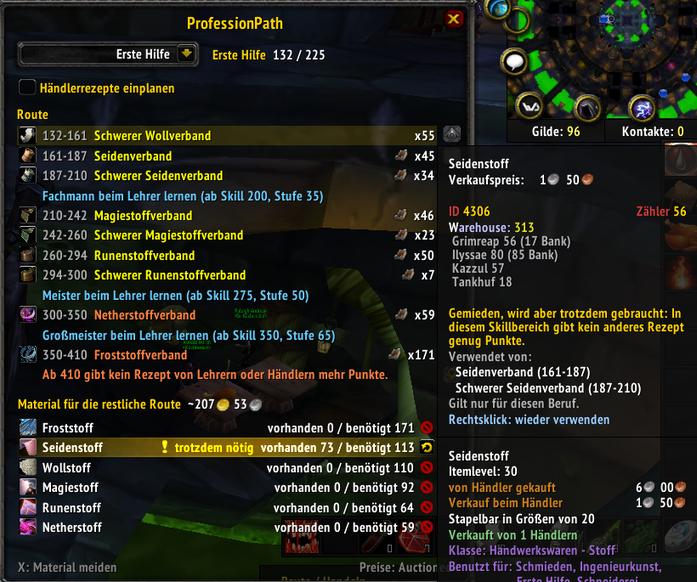
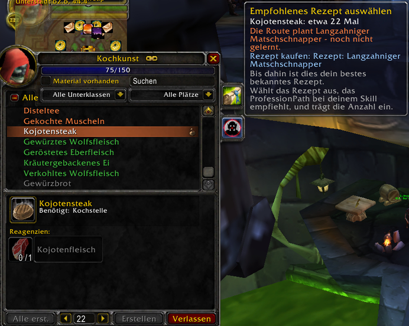
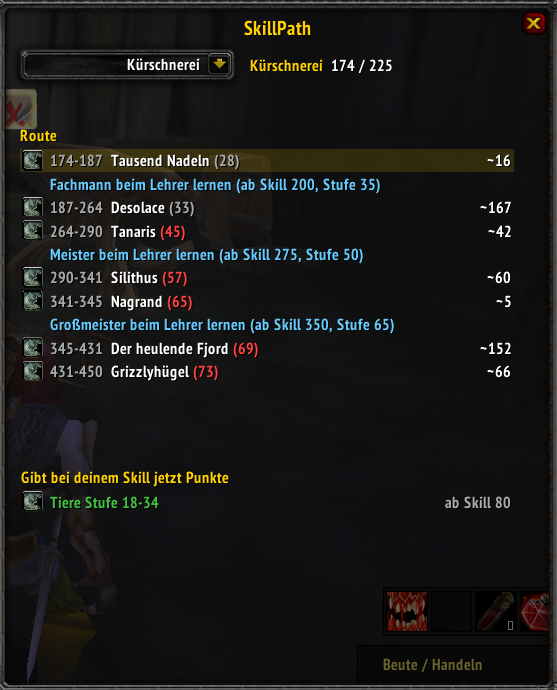
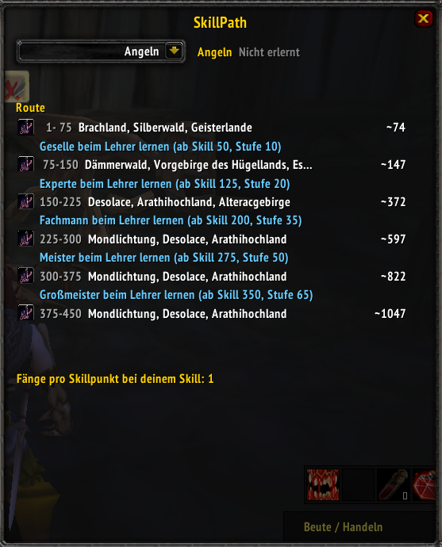

# ProfessionPath

Profession leveling routes for **World of Warcraft 3.3.5a** (Wrath of the Lich King), shown
directly in the game - for every profession, in every client language.

Instead of copying a written guide, ProfessionPath **calculates** the route from the game
data: for every skill point it picks the recipe with the best ratio of skill-up chance to
material cost, out of the recipes you can actually get - and it adapts to your skill, your
known recipes, your bags and the prices on your realm.

*Screenshots are from a German client; recipe, item and zone names always appear in the
language of your client.*

## Contents

- [Installation](#installation)
- [Getting started](#getting-started)
- [The window](#the-window)
- [Crafting professions](#crafting-professions)
- [Materials, prices and avoiding materials](#materials-prices-and-avoiding-materials)
- [The profession window](#the-profession-window)
- [Gathering professions and Fishing](#gathering-professions-and-fishing)
- [How the route is calculated](#how-the-route-is-calculated)
- [Development: how the data is made](#development-how-the-data-is-made)
- [License](#license)

## Installation

1. Download `ProfessionPath-vX.Y.Z.zip` from the
   [latest release](https://github.com/SteffenKoehler/ProfessionPath/releases/latest) and
   extract it into `World of Warcraft/Interface/AddOns/` (it contains the folder `ProfessionPath`).
2. **Restart the game client completely.** WoW 3.3.5a only picks up new addon folders after
   a full restart; `/reload` is not enough.

Optional: [Auctioneer](https://auctioneeraddon.com/) or Auctionator for real auction prices
(see [prices](#materials-prices-and-avoiding-materials)). Everything works without them.

## Getting started

- Open a profession window once per profession, so ProfessionPath knows which recipes your
  character has already learned.
- Open ProfessionPath with the **scroll tab** on the right edge of the profession window, or
  type `/professionpath` (short: `/ppath`).

## The window

From top to bottom:

| Part | What it shows |
|---|---|
| Profession menu | **Your professions** first, then **All professions** with the groups *Crafting*, *Gathering* and *Secondary skills*. Any profession can be looked at, learned or not. |
| Skill | Your current skill and the cap of your rank (e.g. `75 / 150`). |
| *Use vendor recipes* | Also plan recipes that are sold by vendors (crafting professions only). |
| **Route** | The steps from your skill to 450. The current step is highlighted. |
| **Materials** | Everything the rest of the route needs, with the amount in your bags and bank, and the estimated total cost. |
| Bottom line | Hint for the X buttons, and the price source (Auctioneer, Auctionator or estimate). |

## Crafting professions

Alchemy, Blacksmithing, Cooking, Enchanting, Engineering, First Aid, Inscription,
Jewelcrafting, Leatherworking, Tailoring and Mining (smelting).

Each route step shows the **skill range**, the **recipe** colored by difficulty
(orange / yellow / green) and **how often to craft it**. Hover a step to see the recipe with
its reagents.

- **Rank notes** in blue tell you when to visit the trainer for the next rank
  (Journeyman, Expert, Artisan, Master, Grand Master) and the character level it needs.
- **Recipes you have not learned yet** get an icon showing where they come from:
  the **trainer book** (learn it at the trainer, from which skill and for how much),
  the **vendor bag** (buy the recipe from a vendor) or a **scroll** (drop, tokens or
  quest). Hover the icon for details. It disappears once you have learned the recipe and
  opened the profession window.
- When trainers and vendors run out, the route ends with a note and lists the recipes you
  need to continue (drops, token recipes), with their skill range.

With **Use vendor recipes** enabled, the route also uses recipes you can buy:

## Materials, prices and avoiding materials

The material list contains everything the rest of the route needs, sorted by amount, with
`have / need` (bags and bank). Above it is the estimated cost of what you still have to buy.

**Prices**

- Vendor reagents (thread, vials, spices ...) at their vendor price.
- Everything else at the market value from **Auctioneer** or **Auctionator** if installed.
- Without auction data: an estimate from the vendor sell price.
- Intermediates such as bolts of cloth or bars cost the cheaper of buying and crafting them.

Hover a material to see its price per unit and where the price comes from.

**Avoiding a material**

Some materials are hard to get or not worth farming. Click the **red X** next to a material
(or right-click the row) to avoid it: the route is recalculated without it where possible.

- Avoiding applies **only to the selected profession** - silk can be avoided for First Aid
  and still be the cheapest way for Tailoring.
- Avoided materials show an **undo arrow**; click it to use the material again.
- If no other recipe gives enough skill points in a skill range, the route still needs the
  avoided material. Such rows show a yellow **!** and *still needed*; the tooltip explains it
  and lists the steps that use it.

## The profession window

ProfessionPath adds two tabs to the right edge of the profession window, like the tabs of the
spellbook (with skins like ElvUI they sit at the edge of the skinned frame):

- **Scroll** - opens ProfessionPath for this profession.
- **Crosshair** - selects the recommended recipe, scrolls to it and enters the number of
  crafts next to *Create*. If the search box or filters hide the recipe, they are reset.

The recommended recipe is also **marked at the right edge of its row**. Hover the mark to see
how many crafts are left up to the end of the step.

If the route plans a recipe you have not learned yet, the profession window cannot show it.
ProfessionPath then recommends your **best known recipe** that still gives skill points. The
mark is the trainer book or vendor bag of the planned recipe, and the tooltips say which
recipe the route plans and where to get it.

## Gathering professions and Fishing

**Herbalism, Mining and Skinning** show which zone to go to for each skill range, with the
zone level and roughly how often you have to gather.

- The zone with the most herbs, ore veins or skinnable beasts that still give points is
  chosen; spawns are weighted by how often they really appear.
- Zones far above your character level (level shown in red) or of the other faction are only
  suggested when nothing else fits.
- Hover a step to see every herb, ore or beast level range in that zone, colored by
  difficulty at your skill.
- Below the route: what gives skill points at your current skill.

**Fishing** shows, for each rank, zones where you catch fish at that skill and roughly how
many catches it takes; the bottom line shows the catches per skill point at your skill.

## How the route is calculated

- **Skill-up chance** of a recipe: 100 % while it is orange, then falling linearly to 0 when
  it turns grey. Gathering: orange up to +25 above the requirement, yellow up to +50, green
  up to +100.
- For every skill point the planner picks the recipe with the lowest cost per expected
  point: material cost plus a small effort per craft, divided by the chance.
- Recipes with less than 35 % chance (close to grey) are only used when nothing else gives
  points - they need many crafts and lots of materials.
- The current recipe is kept unless another one is clearly better, so the route does not
  jump between recipes for tiny gains.
- Recipes with a cooldown (transmutes, special cloth) are never planned.
- Only recipes available to your character are used: learned with the profession, from the
  trainer (respecting race-specific recipes), from vendors (optional) or already known.

## Development: how the data is made

`ProfessionPath/Data.lua` and `ProfessionPath/GatherData.lua` are generated, not written by
hand. They contain IDs and numbers only; all names are read from the game client at runtime.

1. `tools/extract_dbc.py` reads `SkillLineAbility.dbc`, `Spell.dbc`, `Lock.dbc`,
   `AreaTable.dbc` and `WorldMapArea.dbc` from the client's MPQ archives (recipe skill
   levels, reagents, gathering node skills, zones). The raw files stay local.
2. `tools/build_data.py` combines them with the trainer, vendor and item tables of
   [AzerothCore](https://github.com/azerothcore/azerothcore-wotlk) (GPL-2.0) and writes
   `Data.lua`: where and at which skill a recipe is learned, vendor prices, cooldowns.
3. `tools/build_gather.py` writes `GatherData.lua` from AzerothCore's spawn, loot, pool and
   fishing tables: node spawns and skinnable beasts per zone, zone levels, fishing skill.

Testing outside the game (Python with `lupa`, `luaparser`):

- `tools/test_planner.py <skill line>` prints a crafting route.
- `tools/test_gather.py <skill line> [level] [faction]` prints a gathering or fishing route.
- `tools/smoke_test.py` loads the whole addon against a stubbed WoW API, including the
  profession window.

## License

GPL-2.0 (the recipe and spawn data is derived from AzerothCore's GPL-2.0 database).
World of Warcraft is a trademark of Blizzard Entertainment.
